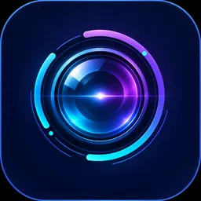

# Optic Rift

> **Architectural source of truth:** [Optic Rift Architectural Index](docs/ARCHITECTURE_INDEX.md). Start there before planning or implementing a component.

**A local-first creative studio for images and video.**

The owner-approved icon shares Sonic Rift’s brand family. See [visual identity and Windows icon generation](assets/branding/README.md).

Optic Rift aims to make AI-assisted visual creation approachable: describe an idea, bring in your own media, preview and edit it, discover models by what they can do, and export the result. The interface is the product; individual models are replaceable engines, not the identity of the application.

**Status (2026-11-05):** architecture and first vertical slice are in development. This is not yet a released or validated editor. No video-generation model is currently qualified.

## Product principles

- **Create, edit, play, export.** A useful editor/player even without an AI model installed. Never present an inoperative button as a feature.
- **Capability first.** Users choose tasks such as text-to-image, image-to-video, text-to-video, inpainting, or upscaling. Models are assigned to tasks, not the other way around.
- **Discover broadly, execute conservatively.** Hugging Face catalog entries can be discovered without implying compatible runtimes. Explicitly distinguish *discovered*, *supported*, *locally verified*, *installed*, and *ready*.
- **Local by default.** Project media, model caches, and inference stay on the user's computer unless the user explicitly opts into an external provider.
- **Licenses are real.** Show model/source/weight licenses and use restrictions before download and at relevant export/use points. Unknown and noncommercial are not treated as permissive.
- **Graceful failures.** Isolate GPU models and their Python dependencies from the editor. If the engine crashes, the project and media remain safe.
- **Performance is a feature.** Keep playback and UI responsive while generation, transcodes, and heavy decoding run off the UI thread.
- **Friendly UX.** No workflow graphs, Python packages, model component vocabulary, or terminal commands required for ordinary use.
- **Clear adult-content choice.** Support lawful adult-oriented models and creation without a blanket pornography ban. Clearly mark adult-focused models **Adult (18+) / Explicit**, keep their discovery behind deliberate opt-in, conceal explicit previews by default, and preserve safeguards for minors, nonconsensual sexual imagery and other illegal or abusive content. Model intent and actual output labels are separate. See [adult-content UX policy](docs/contracts/adult-content-and-preview.md).

## Architecture direction

Preferred initial stack: **Tauri 2 + React/TypeScript UI + Rust native core + FFmpeg for native media work + isolated Python/PyTorch model runners**. Windows 11 is the initial target. See [ADR-0001](docs/architecture/ADR-0001-windows-desktop.md) for alternatives, caveats, performance acceptance gates, and fallback to Qt.

The **first implementation is intentionally a controlled, pre-alpha vertical slice**. It must prove smooth video preview, safe media import, project persistence, and a tested model-catalog boundary before expanding to full timeline editing and model execution.

## Development safety

Do not download model weights, install Python engines, accept gated licenses, access paid APIs, or activate cloud inference automatically. No hosted CI workflows are added by default; owner-controlled local tests and explicit receipts take precedence. Only owner-approved releases or deployment actions should be represented as production ready.

## Roadmap

1. Native shell, non-destructive project state, media viewer/player, simple trim and export.
2. Hugging Face discover/search, model compatibility and licensing disclosure, explicit download consent.
3. First validated local image and video adapters on a 16 GB Windows GPU, isolated dependencies.
4. Multi-clip timeline, transitions, reference-image workflows, previews and generation history.
5. Installer/signing, failure recovery and user-observed usability and performance qualification.

Upstream inspiration: [Sonic Rift](https://github.com/Knapp-Kevin/sonic-rift). Optic Rift is an independent visual-creation application, not a Sonic Rift or ComfyUI plugin.

