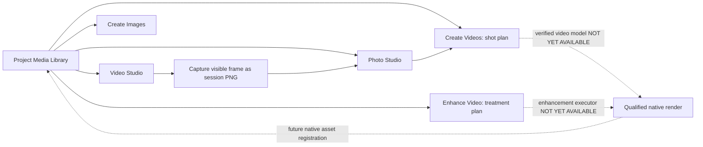

# Optic Rift: whole-product user journeys and screen architecture

**Status:** design/implementation alignment draft, November 8, 2026. Not owner-approved, released, or proof of full implementation. **One source of truth for interactions remains** [studio-interactions.md](../architecture/studio-interactions.md), with P0 tracking at [Issue #29](https://github.com/Knapp-Kevin/optic-rift/issues/29).

## Product intent and boundaries

Optic Rift is **a full photo studio, a full video studio, and a creative workspace linking them**. Generative AI is an optional accelerator, never the only reason the editor works. Ordinary editing, photo/video ingest, inspection and export must eventually operate without models. Project/media provenance should last across restart. Models, provider authorization, file locations, adult content visibility and local/private outputs require separate controls.

**Audio production is out of scope:** no music, speech generation, SFX, soundtrack mixing, dubbing, multitrack audio or audio model marketplaces. Future video exports may preserve existing embedded audio as a codec/transport compatibility matter; that does not create an audio workstation.

## Navigation (designed around work, not APIs)

| Left navigation | Destination | Real current scope on this development branch |
| --- | --- | --- |
| Your Work → Projects | Named local project list | Project metadata, not durable imported project media |
| Your Work → Media Library | Shared session photos/videos and generated history | Search, filter, explicit open in editor, no unsolicited thumbnail |
| Your Work → Workflows | Searchable journey directory | 25 entries with real status, acceptance evidence requirement and next route |
| Generate → Create Images | Image generation | Verified native T2I/I2I on ancestor Windows branches; GPU/job consent needed |
| Generate → Create Videos | Shot/storyboard planning | T2V, photo-to-video, video-to-video input intent, references, duration, aspect, camera and content intent; **NO video render** |
| Edit & Enhance → Photo Studio | Offline photo editor | Basic adjustments, bounded canvas preview and explicit PNG export; not complete layers/masks/ICC |
| Edit & Enhance → Video Studio | Visual editor/playback | Local playback, seek, preview in/out markers, experimental frame capture; no timeline export |
| Edit & Enhance → Enhance Video | Quality/restoration plan | Denoise/upscale/stabilize/interpolate/deinterlace/color/sharpen/scratch-repair selection; **NO processing** |
| Tools → Models | Optional capability discovery/qualification | Discovered model metadata ≠ supported/installed/verified/executable |
| Tools → Settings | Device/privacy preferences | Session opt-in for adult model discovery is distinct from content-intent and native policy |

Each destination must be usable or plainly labeled a planner/unsupported boundary. **Do not add dead Generate, Render, Apply, or Export controls.**

## User experience: five connected modes

1. **Browse**: Open/recover project → Media Library → assets, versions, licenses, origin, privacy and disclosure. Persistent storage/lineage remains an unfinished native contract.
2. **Create**: describe visual intent → choose text/image/video reference → configure frame/aspect/duration/shot/camera, consent and model readiness → queued job → validation → new asset. Image generation has real ancestor evidence. Video planning has draft UI only and **cannot generate**.
3. **Edit**: select Photo or Video Studio → deterministic editing without model → nondestructive recipes and comparisons → explicit output location and verified export. Current working slice is basic photo raster output; video editing is not qualified.
4. **Enhance & restore**: choose damaged source, select quality problems → measured before/after → bounded qualified local processing → new revision, traceable method and artifacts. UI can only review a **proposed treatment** today.
5. **Produce**: storyboard → shots/scenes → reused character/location references → multi-track visual timeline → grading/titles/transitions → final film export and delivery variants. Shot planning is present; durable storyboard, timeline and render are not.

## Cross-media reference flow

An image/video frame reference is never itself a model execution grant. User-created copies are identified separately from originals. Frame timestamps must be recorded with their actual precision, never fabricated as frame-perfect. The source can remain private even if a resulting photo is deliberately exported to OneDrive-backed Pictures. Generate, Enhance and Export are distinct consent boundaries.

## Specific filmmaker story acceptance

A short filmmaker should be able to start from a new project and set overall intent (general themes / mature themes / adult-focused), then create scenes and shots, import reference photos and existing footage, build shots from text or media, edit the resulting clips, extract a key frame into Photo Studio for retouching, use that derived frame as a new generation reference, perform video restoration/upscaling, arrange shots and photos on a **visual** timeline, review the film and export an actual movie. Each shot should show an immutable source, derivation, license, version, status and actionable reason if blocked.

**Today:** The draft branch only supports session shot planning, basic local clip preview, session frame capture and real basic photo edits. No scene-movie generator, timeline, complete private output or video exporter is present. **Adult-focused planning labels do not qualify adult content execution, override source licensing, or establish age verification.**

## Video enhancement story acceptance

A user imports old, grainy or shaky footage, checks the source format/frame rate/resolution and selects desired treatments: noise reduction, color restoration, stabilization, upscaling, scratch repair, interlace removal or motion smoothing. The UI must show expected quality tradeoffs and limits. A qualified pipeline later needs:

- source and output codecs, exact frame timestamps and bounded proxy handling;
- local compute/device costs, GPU budget and cancel/restart safety;
- per-treatment preview and side-by-side comparison at selected frames;
- truthful output metadata, rights/provenance, no source overwrite, deliberate output destination;
- rigorous image-quality tests across interlaced, HDR, wide-gamut and synthetic/real footage.

The current UI **only plans** these transformations. No enhancement operation executes today.

## Target end-to-end test matrix

The runtime module `src/creativeJourneys.ts` contains 25 explicitly bounded journeys with current status and acceptance criteria across Photo, Video, Production, Enhancement, and Privacy & projects. Tests require every route to exist and every future-only operation to be shown as **not implemented** rather than a dead button.

A story is complete only when:
1. the user can discover the action from the right workspace;
2. the source and all prerequisites are clear, permissions separate;
3. the real operation runs with failure/cancel/restart behavior, not a fake renderer;
4. output is validated, versioned, recoverable and traceable to source;
5. the user can reuse the output in the next workflow with no awkward export/re-import;
6. independent review, Qortara governance, authorized main merge and **post-merge Windows qualification** exist.

### Design approval still required

Before freeze, produce screen-sized, linked wireframes for Projects/Library, photo edit, video edit, video shot composer, video enhancement/quality comparison, production storyboard/timeline, cross-media lineage, model selection and output/privacy review. Test the full task flow with novice and experienced users at 1280×720 and 1440×900. Include empty, loading, error, unsupported and offline states. None of the textual planning screens here substitute for owner-approved professional photo/video wireframes.
