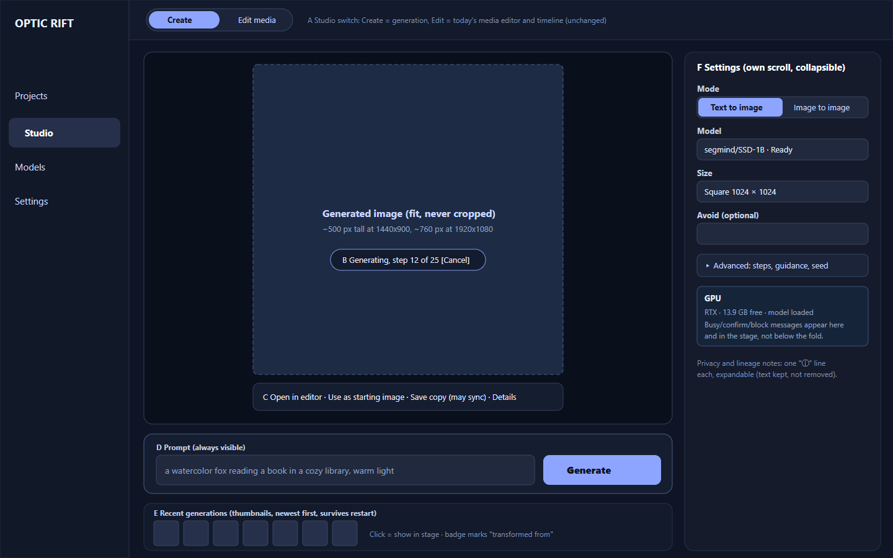
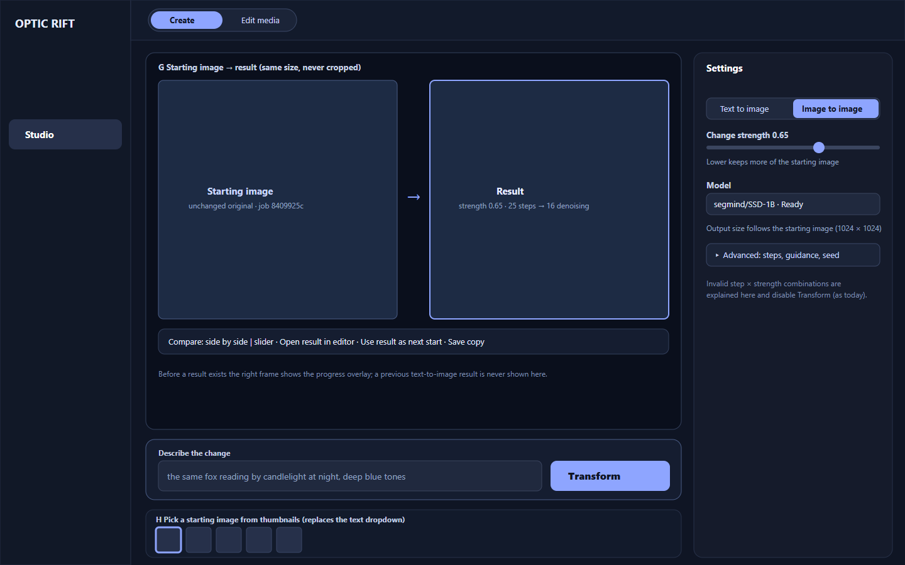

# Studio UX baseline and redesign proposal (issue #21)

Evidence for [issue #21](https://github.com/Knapp-Kevin/optic-rift/issues/21). This folder holds captured screenshots, measurements and a **proposal**. It is not an accepted design, and it changes no application code.

## What was captured

| | |
|---|---|
| Application commit | `3af04facc4f86ebbf7fb187228d7b8a0982614d5`: the [PR #20](https://github.com/Knapp-Kevin/optic-rift/pull/20) head that passed Windows-local qualification. Release build, exe SHA-256 `eeba7ee44c67f1c0…`. |
| Host | Windows 11 Pro 26H2 (10.0.26300.9711), RTX 5070 Ti 16 GB, driver 621.01, WebView2 157.0.4341.42 |
| Display | Primary 3440×1440 and secondary 1920×1080, both at **100 % scaling (96 DPI)**. 125 % was **emulated** in the webview (CSS viewport 1536×864 at device-pixel ratio 1.25), not set in Windows. |
| Method | The real Tauri app was driven through a loopback-only WebView2 DevTools port. Exact CSS viewports were set with `Emulation.setDeviceMetricsOverride`, so sizes are the app's content area without window chrome. The GPU was confirmed idle before each generation (owner-approved). |
| Content | Fictional prompts only (a watercolor fox; earlier test lighthouses). Generated with `segmind/SSD-1B` (Apache-2.0). No tokens, user paths or personal media appear. The Models page, which shows the local model folder path, was not captured. |
| Files | 42 screenshots in `screenshots/`, 4 annotated in `annotated/`, layout measurements in `metrics.json`, and 2 proposed wireframes in `proposed/` (SVG plus PNG). |

Screenshot names are `<state>--<viewport>.png`. The `1440xFULL` captures extend the viewport to the full page height, so the whole sidebar is visible.

| State | 1440×900 | 1920×1080 | 1280×720 | 1920×1080 @125 % (emulated) |
|---|---|---|---|---|
| Studio before generating | [01](screenshots/01-studio-before-generating--1440x900.png) | [01](screenshots/01-studio-before-generating--1920x1080.png) | [01](screenshots/01-studio-before-generating--1280x720.png) | [01](screenshots/01-studio-before-generating--1920x1080@125pct.png) |
| Full page height, before generating | [01b](screenshots/01b-full-extent-before-generating--1440xFULL.png) | | | |
| Text-to-image controls filled in | [02](screenshots/02-text-to-image-controls-filled--1440x900.png) | [02](screenshots/02-text-to-image-controls-filled--1920x1080.png) | [02](screenshots/02-text-to-image-controls-filled--1280x720.png) | [02](screenshots/02-text-to-image-controls-filled--1920x1080@125pct.png) |
| Generating (progress) | [03](screenshots/03-text-to-image-progress--1440x900.png) | | | |
| Completed, page top | [04](screenshots/04-completed-result-viewport-top--1440x900.png) | [04](screenshots/04-completed-result-viewport-top--1920x1080.png) | [04](screenshots/04-completed-result-viewport-top--1280x720.png) | [04](screenshots/04-completed-result-viewport-top--1920x1080@125pct.png) |
| Completed, scrolled to result and actions | [04b](screenshots/04b-completed-result-scrolled-to-result--1440x900.png) | [04b](screenshots/04b-completed-result-scrolled-to-result--1920x1080.png) | [04b](screenshots/04b-completed-result-scrolled-to-result--1280x720.png) | [04b](screenshots/04b-completed-result-scrolled-to-result--1920x1080@125pct.png) |
| Completed, full page height | [04c](screenshots/04c-completed-full-extent--1440xFULL.png) | | | |
| Image-to-image, source selected | [05](screenshots/05-image-to-image-source-selected--1440x900.png) | [05](screenshots/05-image-to-image-source-selected--1920x1080.png) | [05](screenshots/05-image-to-image-source-selected--1280x720.png) | [05](screenshots/05-image-to-image-source-selected--1920x1080@125pct.png) |
| Image-to-image controls | [05b](screenshots/05b-image-to-image-controls-scrolled--1440x900.png) | [05b](screenshots/05b-image-to-image-controls-scrolled--1920x1080.png) | [05b](screenshots/05b-image-to-image-controls-scrolled--1280x720.png) | [05b](screenshots/05b-image-to-image-controls-scrolled--1920x1080@125pct.png) |
| Image-to-image progress | [06a](screenshots/06a-image-to-image-progress--1440x900.png) | | | |
| Image-to-image result, page top | [06](screenshots/06-image-to-image-result-viewport-top--1440x900.png) | [06](screenshots/06-image-to-image-result-viewport-top--1920x1080.png) | [06](screenshots/06-image-to-image-result-viewport-top--1280x720.png) | [06](screenshots/06-image-to-image-result-viewport-top--1920x1080@125pct.png) |
| Image-to-image result, scrolled | [06b](screenshots/06b-image-to-image-result-scrolled--1440x900.png) | [06b](screenshots/06b-image-to-image-result-scrolled--1920x1080.png) | [06b](screenshots/06b-image-to-image-result-scrolled--1280x720.png) | [06b](screenshots/06b-image-to-image-result-scrolled--1920x1080@125pct.png) |
| Recent generations | [07](screenshots/07-recent-generations--1440x900.png) | [07](screenshots/07-recent-generations--1920x1080.png) | [07](screenshots/07-recent-generations--1280x720.png) | [07](screenshots/07-recent-generations--1920x1080@125pct.png) |
| Result opened in the Studio preview | [08](screenshots/08-result-opened-in-canvas--1440x900.png) | | | |
| Keyboard focus after 40 Tab presses | [09](screenshots/09-keyboard-focus-after-40-tabs--1440x900.png) | | | |

## Answers to the review questions

1. **Can a new user immediately see how to generate an image?** No. The largest, brightest call to action in the Studio is "Make something extraordinary / **Import your first clip**", and the preview says generation will arrive "as compatible models become available". Generation lives in a 292 px column on the right, headed "Creation tools".
2. **Is the generated result the visual focus?** No. At 1440×900 it renders as a 253×253 px thumbnail at y=842, cut off by the bottom of the window. The 632×356 px central preview keeps showing the empty import prompt next to it ([A1](annotated/A1-result-not-the-focus--1440x900.png)).
3. **Are essential actions visible without too much scrolling?** Only sometimes.
   - At 1440×900, "Generate locally" is visible but the result is not.
   - In image-to-image, "Transform locally" sits at y=999, below the fold, at both 1440×900 and 1280×720.
   - At 1280×720, Generate (y=752) is below the fold too ([A2](annotated/A2-small-window-fold--1280x720.png)).
   - The page grows to 1,400 px tall before generating and to 2,453 px after a few results.
4. **Does image-to-image make the source/result relationship clear?** No. The source is a text dropdown (truncated prompt · size · ID) with no thumbnail. Under "Transform locally" the panel still shows the *previous text-to-image* result with a different seed, and there is no side-by-side view ([A3](annotated/A3-img2img-relationship--1440x900.png)).
5. **Does it feel like a creative application?** It reads as a settings form: a long single column of 11–12 px labels and explanation paragraphs beside an empty canvas.

## Findings, ranked

| # | Urgency | Problem | Evidence | Impact |
|---|---|---|---|---|
| 1 | **P0** | **The result is not the focus.** Output is a 253 px thumbnail in the sidebar while the 632 px (1440 wide) or 1,112 px (1920 wide) central preview stays empty with an "Import your first clip" prompt. | [A1](annotated/A1-result-not-the-focus--1440x900.png); `metrics.json` `04-…`: `result_image.w=253`, `canvas.w=632/1112` | Users can't judge what they made; the main purpose of the screen fails. |
| 2 | **P0** | **The whole page scrolls; nothing scrolls on its own.** The sidebar has `overflow: visible`, so reaching results or history scrolls the preview and header away. | Document heights 1,400 → 2,453 px; [03](screenshots/03-text-to-image-progress--1440x900.png) shows progress with the preview gone; [04c full height](screenshots/04c-completed-full-extent--1440xFULL.png) | Constant scrolling; primary action and result are never on screen together. |
| 3 | **P1** | **Image-to-image doesn't show its relationship.** Text-only source picker; a stale previous result is shown under "Transform"; no before/after view. | [A3](annotated/A3-img2img-relationship--1440x900.png), [05](screenshots/05-image-to-image-source-selected--1440x900.png), [06b](screenshots/06b-image-to-image-result-scrolled--1920x1080.png) | Users can mistake the old output for the transform result; choosing a source by text is error-prone. |
| 4 | **P1** | **Progress is a small text line in the sidebar** ("Checking installed model files…", "step 12 of 25"). No progress bar or overlay where the image will appear. | [03](screenshots/03-text-to-image-progress--1440x900.png), [06a](screenshots/06a-image-to-image-progress--1440x900.png) | The 10–25 s wait feels unresponsive, and Cancel is easy to miss. |
| 5 | **P1** | **Square outputs are cropped in the preview** (and any tall image in the Edit view). `.canvas` is a 16:9 frame with `overflow:hidden`, while `.canvas img` uses `height:100%` capped at `calc(100vh - 390px)`: 510 px at 900 px tall versus a 356 px frame. | [A4](annotated/A4-square-output-cropped--1440x900.png): the book and shelves are cut off | The preview misrepresents the image; affects editing too. A small CSS fix, independent of the redesign. |
| 6 | **P2** | **History is buried and text-only.** A 544 px nested scroll box sits at the bottom of the sidebar, starting about 1,376 px down. Rows show a truncated prompt, metadata and buttons, with no thumbnails. | [07](screenshots/07-recent-generations--1440x900.png), [04c](screenshots/04c-completed-full-extent--1440xFULL.png) | Hard to find or compare earlier results; two scrollbars at once. |
| 7 | **P2** | **Small type and long explanations inside the control flow.** Result metadata and history details are 10 px, hints 11–12 px. Privacy and lineage explanations sit between controls. Colour contrast passes WCAG AA (5.45–10.95:1); the issue is size and density. | [04b](screenshots/04b-completed-result-scrolled-to-result--1440x900.png), [05b](screenshots/05b-image-to-image-controls-scrolled--1440x900.png) | Hard to read, especially at 125 %; the important notes become wallpaper. |
| 8 | **P2** | **Space spent on things unrelated to generation.** The empty media-library column (245 px) and the empty "Timeline preview" for stills stay on screen; at 1920 wide the 1,160 px centre column is mostly empty. | [01 at 1920](screenshots/01-studio-before-generating--1920x1080.png), [06b at 1920](screenshots/06b-image-to-image-result-scrolled--1920x1080.png) | The generation surface feels cramped while most of the window is idle. |
| 9 | **P3** | **Out-of-date and confusing copy.** "Explore AI generation as compatible models become available" while a model is installed and working; "Import your first clip" as the main Studio action. The capability list mixes runnable and not-yet-runnable options without marking them. At 1280×720 the empty-state button is clipped by its own frame. | [01 at 1280](screenshots/01-studio-before-generating--1280x720.png), [A2](annotated/A2-small-window-fold--1280x720.png) | Mixed signals about what the product can do. |

**Accessibility notes.**
- Tab order is logical: navigation → header → media → capability → prompt → model → settings → primary button (20 presses in image-to-image mode); see `metrics.json` `tab_order`.
- Inputs have labels: Steps, Guidance and Seed are wrapped in `<label>` elements. Progress uses `role=status`, and focus-visible styles exist.
- No horizontal overflow at any captured size.
- Main risks: the nested scroll regions, and the 10 px text.

## Proposed layout (for owner and ChatGPT review)

Wireframes only, using the existing palette; not a visual redesign. Source files: [text to image SVG](proposed/proposed-create-text-to-image-1440x900.svg) and [image to image SVG](proposed/proposed-create-image-to-image-1440x900.svg).

- **A. Studio gets a two-way switch, Create | Edit media.** *Edit media* is today's media library, preview and timeline, unchanged. *Create* is the generation surface. Nothing is removed and app navigation is unchanged.
- **B / G. The centre stage is the result,** fitted and never cropped: about 500 px tall at 1440×900, about 760 px at 1920×1080. Progress and Cancel are an overlay on the stage. In image-to-image the stage shows **starting image → result** side by side (with an optional slider), and a previous text-to-image result is never shown there.
- **C. Result actions sit directly under the image:** Open in editor, Use as starting image, Save copy (may sync), and Details (provenance).
- **D. The prompt bar and the primary Generate/Transform button are always visible** at the bottom of the stage, without scrolling, at 1280×720 and up.
- **E / H. Recent generations become a thumbnail filmstrip** under the prompt. Clicking shows an image in the stage. In image-to-image the same strip is the source picker, replacing the text dropdown, and keeps the "transformed from" badge.
- **F. One settings panel (about 316 px) with its own scrolling, collapsible.** It holds mode (segmented control), model with Ready state, size or strength, Avoid, and a collapsed **Advanced** section (steps, guidance, seed). GPU busy/confirm/block messages stay in this panel and are mirrored on the stage. The OneDrive, lineage and strength explanations remain, shortened to one-line expandable notes.
- **Preserved:** GPU preflight and consent, cancel, the no-overwrite save, OneDrive disclosure, license and gated labels, the 18+ discovery opt-in, local-only execution, honest unsupported-capability messages, and generation history that survives restart. **No backend, model or IPC changes are required for the layout.**

### Decisions needed before building
- **Owner decision:** whether Create becomes the Studio's default view once a model is installed.
- **Owner decision:** thumbnails. `generation_output_image` returns full 1024² PNGs (about 1.4 MB each in base64). The options are:
  - lazy-load only the 6–8 visible thumbnails (no backend change);
  - add a small native read-only thumbnail command (a backend change, needs review).
- **Confirmed vs proposed:** findings 1–9 are measured on the captured build. The layout, sizes and labels in the wireframes are proposals.

### Suggested implementation steps (separate UI branch from the PR #20 head, after review)
1. **Small fix first:** make `.canvas` images fit their frame. The image's `max-height` should follow the frame, not the viewport. Re-capture A4.
2. Move the generation request/progress/result state out of `GeneratePanel` into a reusable hook. Behaviour stays identical; the existing tests keep passing.
3. Build `CreateWorkspace` from Stage, PromptBar, SettingsPanel and Filmstrip, reusing the same commands. Add scroll containment: the panels scroll themselves, never the page.
4. Add the image-to-image compare view and the thumbnail source picker. Never show a stale result for another mode.
5. Add the Create | Edit media switch, keeping the current editor untouched.
6. Re-run `npm run build`, `test:content` and a Windows smoke test. Re-capture this exact screenshot set at the same four sizes for a before/after comparison.

*Prepared by Claude Code on the owner's Windows workstation. These are observations and a proposal, not an independent review or governance approval.*
